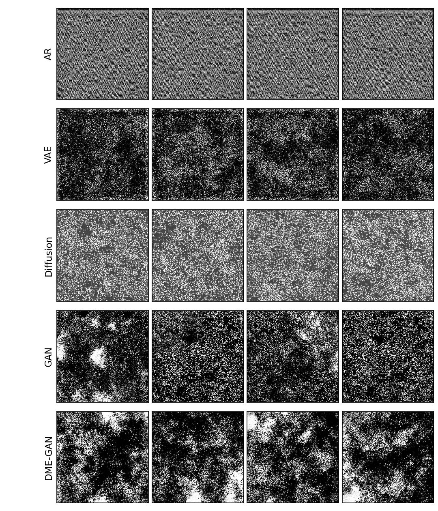

# Carbon-ceramic DME-GAN examples

Example resources for **Morphology-constrained generative design of heterogeneous microstructures with adaptive tail-risk electrothermal guidance**.

Version 1.3.0 provides inference with the dual-scale morphology-envelope-constrained generative adversarial network (DME-GAN) selected at **epoch 270**, matching the morphology-generation model reported in the manuscript. It also provides agent-assisted training, frozen-ensemble feedback, event-triggered control, per-image morphology analysis and retained-data screening.

## Included data

- 32 carbon-element characterization maps.
- 20 saved generated fields each for autoregressive (AR), variational autoencoder (VAE), diffusion and generative adversarial network (GAN) models.
- 500 retained DME-GAN fields from the existing data release.
- 302 physical-response records: 300 candidate entries and two benchmark records.
- A 300-record table containing 21 structural features and the retained physical responses.
- Four-model settings, material inputs and response-model settings.
- Paired section fields for 300 retained response records and their consistently encoded smooth feedback inputs.

The four comparison-model subsets use the first saved entries in numeric order. The existing 500 DME-GAN PNGs, image index, descriptor tables and preview are retained unchanged. Their original identifiers, source populations and SHA-256 hashes remain in `data/image_index.csv`. PNG quantization can change descriptor values relative to floating-point evaluation; the example summaries describe the released PNGs.



## Run the examples

Use Python 3.12. Open a terminal in the repository root and run:

```text
python -m pip install -r requirements.txt
python scripts/verify_manifest.py .
python scripts/run_examples.py --out results/example_run --device cpu
```

The default run calculates descriptors for all 612 saved images, screens the 300 candidates against the two benchmarks, and generates 20 new DME-GAN fields. To generate 50 new fields instead:

```text
python scripts/run_examples.py --out results/example_50 --device cpu --count 50
```

The sampling example supports 1-100 fields per run. New fields, float32 arrays and random-state information are saved separately from the retained study data. Use a new or empty output directory.

For saved-data analysis without installing PyTorch:

```text
python -m pip install -r requirements-analysis.txt
python scripts/run_examples.py --out results/analysis --skip-generation
```

## Inputs and outputs

- `data/characterization/`: reference maps for image preparation and morphology analysis.
- `data/generated_examples/{ar,vae,diffusion,gan,dmegan}/`: retained generated-image sets.
- `data/checkpoint/`: three checkpoint parts and `selected_generator.pt.parts.json`.
- `data/responses/`: transient, mechanical and structure-response tables.
- `data/model_settings/` and `configs/`: reported settings and inference configuration.
- `data/derived/`: precomputed descriptor summaries and response-screening results for the released data.
- `src/dmegan_examples/`: the matching epoch-270 generator, checkpoint loader, image descriptors and screening functions.
- `docs/data_dictionary.md`: definitions, units and data relationships.
- `validation/`: verification records; `MANIFEST.json`: file sizes and SHA-256 hashes.

The run produces `image_descriptors.csv`, `descriptor_group_means.csv`, `response_screening.csv` and `example_summary.json`. Generation additionally creates a `new_fields/` directory containing PNGs, float32 fields and sampling information.

## Checkpoint and study scope

The released inference architecture and every state tensor are preserved from the selected epoch-270 model. The retained image data remain separately indexed by their original source; this checkpoint update does not change their provenance. This architecture accepts a latent vector and does not require a reference-image bank. The inference export contains generator parameters and buffers; discriminator and optimizer states are not needed for sampling.

The checkpoint is stored as three byte-exact parts, each smaller than 25 MB. Keep all `.partNN` files and `selected_generator.pt.parts.json` together. The loader verifies the part and combined SHA-256 hashes and reassembles the checkpoint in memory. An optional `python scripts/restore_checkpoint.py --out results/selected_generator.pt` command restores a standalone file.

Four-model images are retained examples; this release does not implement inference or retraining for those four models. The 14 image-evaluation descriptors and 21 structure-response features have different definitions, documented in the data dictionary.

The response tables are retained numerical outputs supplied for fixed-data screening. They are analyzed independently of checkpoint inference; no one-to-one mapping from the 500 DME-GAN PNGs to response rows is supplied. The three 100-entry candidate cohorts can overlap. Screening converts milliseconds to seconds for temperature integration and applies the stated electrothermal and modulus benchmarks.

The training entry point implements the DME-GAN structural objective with differentiable ensemble-surrogate feedback, event-triggered gain control and checkpoint protection. It starts a new run and writes its results separately. The fixed epoch-270 inference weights retain their original provenance. Finite-element responses are supplied as retained numerical outputs; new solver runs require the external simulation workflow.

## Agent-assisted optimization

Check the 21-dimensional paired encoding, fit the 12-member random-Fourier-feature ensemble, and verify that response gradients reach its inputs:

```text
python scripts/run_agent_example.py --out results/agent_check
```

Start a new agent-assisted training run:

```text
python scripts/train_agent.py --out results/agent_training --device cuda
```

Use `--device cpu --quick` for a reduced-capacity software check. The scientific configuration is in `configs/agent_training.json`. Full runs use the 32 supplied characterization maps and the paired feedback table. Each epoch fixes the fitted response model and current feedback gain; the controller selects the gain for the next epoch. Query events are written to a request queue.

To recompute control decisions from a new run's state log:

```text
python scripts/replay_agent_controller.py --log results/agent_training/logs/physics_feedback_log.csv --out results/controller_replay
```

Add `--quick` when replaying a quick-run log. See [agent methods and data](docs/agent_methods.md) for the feature schema, risk units, event order, checkpoint protection and relation to the manuscript.

## Licence and citation

Software is licensed under [MIT](LICENSE). Data and checkpoint weights in `data/` are licensed under [CC BY 4.0](LICENSES/CC-BY-4.0.txt); see [data licensing](data/LICENSE.md). Citation metadata are in [CITATION.cff](CITATION.cff).

Access statements and the release scope are recorded in [AVAILABILITY.md](AVAILABILITY.md). Repository releases can identify fixed software versions; an archived DOI can be added after deposit.
